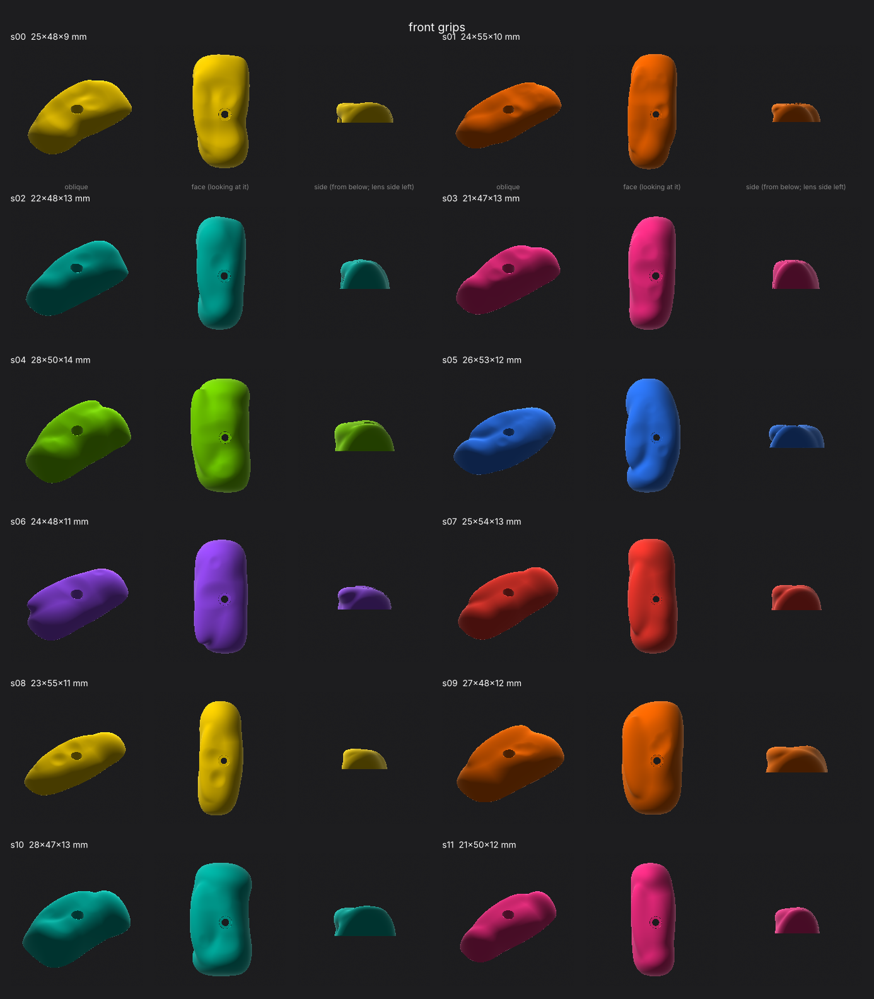
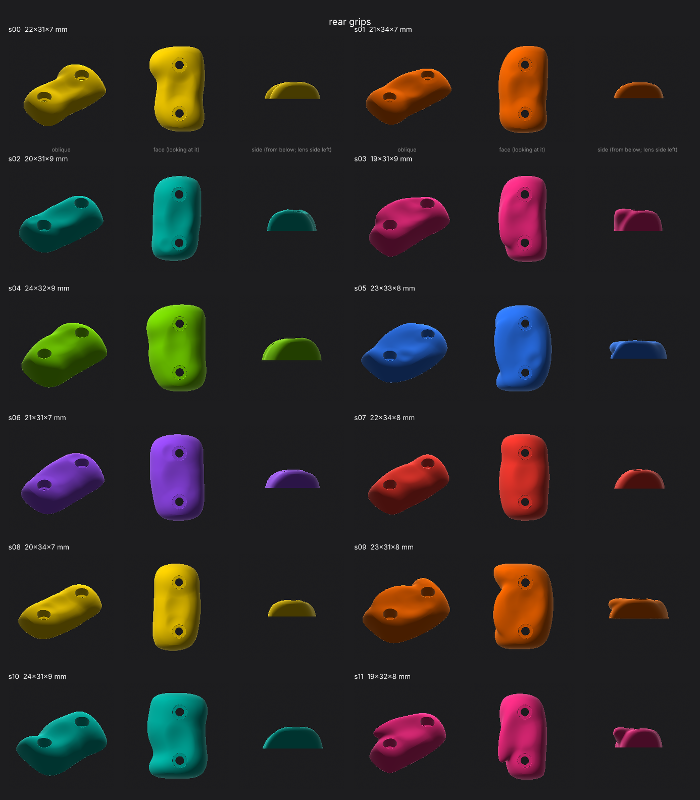
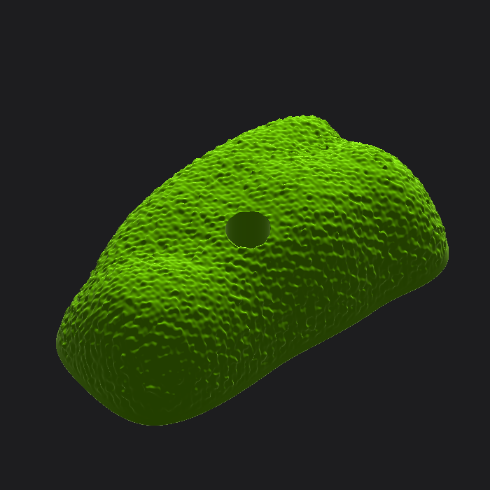

# Bouldering-hold grips

Seeded generator for organic, brightly coloured grips that bolt onto the camera body.
**Front:** a finger crimp, 1× M2.5 SHCS + Ø2 mm dowel pin. **Rear:** a thumb sloper with a dish, 2× M2.5 SHCS.
Every grip has a flat mating face, and the fastener geometry is exact. Output is a watertight STL for MJF.





## Use

```bash
pip install numpy scipy scikit-image trimesh matplotlib
python3 gripgen.py front --seeds 0-11            # out/front_s00.stl … + params .json
python3 gripgen.py rear --good 12                # first 12 seeds that pass every check
python3 gripgen.py front --seeds 4 --texture --voxel 0.15   # print-ready, with hold grain (~20 MB)
python3 sheet.py front front_sheet.png --seeds 0-11         # contact sheet: oblique / face / side
```

A seed always gives the same grip, so "front s04" names a design. Its parameters are saved beside the STL.

## How it works

1. **Signed distance field.** Each grip is a function `d(x, y, z)`: negative inside, positive outside, zero on the surface. Shapes combine with simple arithmetic: `min` = union, `max` = intersection, `max(a, -b)` = cut b out of a. *Smooth* min/max blend the join with a fillet radius `k`, which is what makes it organic.
2. **Recipe per seed** (`make_params`), random within the bounds:
   - 3–5 **lobes** (ellipsoids) along the height, sized to fit the footprint, centres sunk 15–40 % below the mating face so the edges come down to the body.
   - A **lip** on the lens side (front: the crimp edge your fingertips curl over) or the EVF side (rear: a rim that cradles the thumb; 70 % of seeds).
   - **Dents** (1–4 shallow scoops) for the faceted look of a cast hold; front **finger scallops** (0–3); rear **thumb dish** between the screws.
3. **Fastener bosses** are added *after* the carving, so dents and the dish can never thin the material around a screw.
4. **Bounds:** a soft box clip (only a safety net), then a hard cut at z = 0, which gives an exactly flat mating face.
5. **Holes** are cut last and exactly: Ø3.0 clearance, Ø5.2 counterbore from the seat up, Ø2.15 × 4 mm blind pin hole.
6. **Checks** (`check`), on every seed:
   - ≥ 2.5 mm wall around each counterbore;
   - the screw head sits ≥ 0.3 mm below the surface all round its rim;
   - ≥ 1.5 mm of material over the pin hole.
7. **Mesh:** marching cubes on a 0.3 mm grid (0.15 mm with texture), keep the largest piece, fix normals → watertight STL.
8. **Texture** (optional): 28 random plane waves, 0.6–1.6 mm wavelength, ±0.07 mm. It fades out near the mating face, and holes are cut after it.

## Bounds and fasteners (edit `BOUNDS` and the constants at the top)

| | Front | Rear |
| --- | --- | --- |
| Footprint W × H | 20–28 × 45–55 mm | 18–24 × 30–34 mm |
| Protrusion | 9–14 mm | 6.5–9 mm |
| Seat under head | 3.0 mm | 2.5 mm |
| Fasteners | 1× M2.5 at centre, dowel 0.55 × H/2 above | 2× M2.5 at ±0.55 × H/2 |

Coordinates: x across the camera (−x = lens side on the front, EVF side on the rear), y up, z out of the body.
For a grip on the other hand, mirror x in Fusion.

**Screw length** = seat + thread engagement. With ≥ 4 mm of thread in the body: front M2.5×8, rear M2.5×6 or ×8.
Tapped aluminium, or brass heat-set inserts in a printed body.
**Dowel:** Ø2 mm × 6 mm, pressed into the body; the grip slides over it (Ø2.15 hole allows for MJF shrink).

## Into Fusion

- **Mesh workspace:** Insert > Insert Mesh, pick the STL, place it on the body face (the mating face is z = 0).
- For a solid: **Modify > Convert Mesh**. *Faceted* works on any mesh. For a smooth editable body, first **Remesh** (to a few thousand quads), then convert *Organic*, or rebuild over it in Form.
- STEP from a mesh is still faceted; for MJF printing, send the STL (or 3MF) as-is.

## Making them

- **MJF PA12, dyed:** tough, slightly grainy (that suits the look).
- **Bright colours:** dyed MJF is limited and mostly dark. For fluoro yellow, orange or magenta, either:
  - use MJF in white and dye it yourself (RIT DyeMore for synthetics), or
  - cast pigmented urethane from a silicone mould of an MJF master, like real holds.
