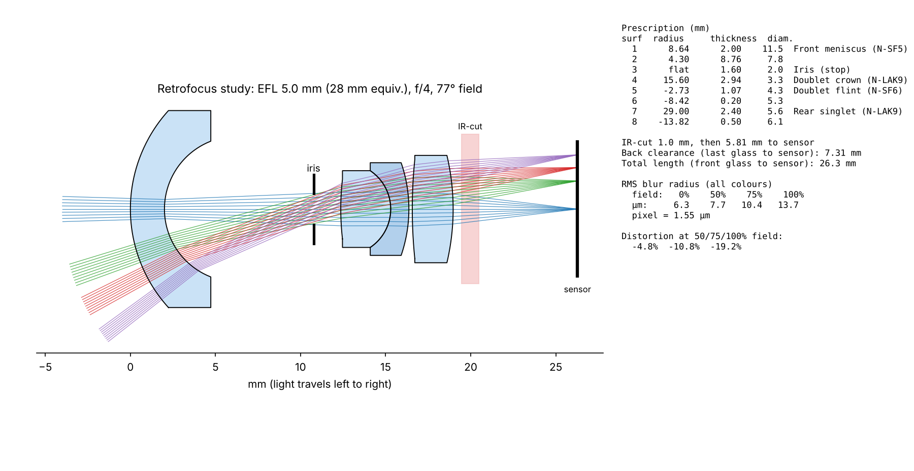

# Retrofocus wide study (5 mm, 28 mm equivalent on the HQ camera)

First-order design study for a home-built wide lens: negative front meniscus, iris, cemented doublet, rear singlet, 1 mm IR-cut plate, sensor. Spherical surfaces, Schott glasses (N-SF5, N-LAK9, N-SF6), F/d/C wavelengths. Own vectorised real-ray tracer (`retro.py`), Nelder-Mead + Powell optimisation (`opt.py`), drawing (`draw.py`).



| Version | Corner distortion | RMS blur radius 0 / 50 / 75 / 100 % field | Back clearance |
| --- | --- | --- | --- |
| v1 (`retro_f4_v1.json`) | −19 % | 6.3 / 7.7 / 10.4 / 13.7 µm | 7.3 mm |
| d12 (`retro_f4_d12.json`) | −16 % | 5.6 / 11.3 / 17.5 / 25.4 µm | 5.6 mm |
| distortion forced to 8 % | −11 % | 12 / 58 / 110 / 175 µm (failed) | — |

Pixel = 1.55 µm. With four elements, sharp corners and low distortion trade against each other; v1 plus software distortion correction, or a fifth element, are the ways forward.

Caveats: the entrance pupil is taken as paraxial and circular (no pupil aberration or vignetting), no tolerance analysis, glasses not matched to catalogue parts. Confirm in a full optical design tool before making anything.

```bash
pip install rayoptics            # for the opticalglass Schott catalogue
python3 opt.py 4.0 [max_distortion] [weight] [tag]
python3 draw.py retro_f4_v1.json out.png
```
