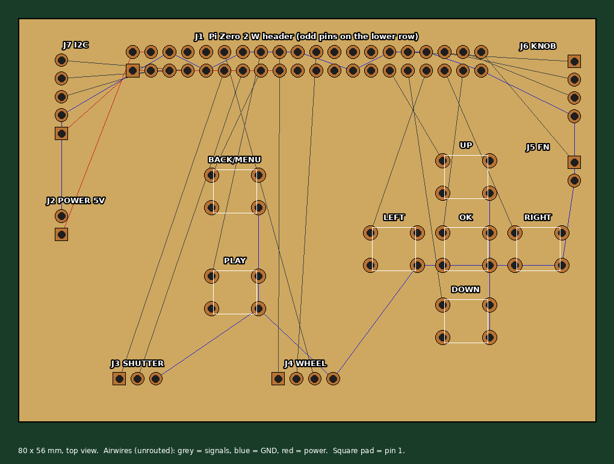

# Test mainboard v0.1

First PCB for learning Fusion Electronics: connects the Pi Zero 2 W to the rear controls and to connectors for everything else. Placed but **not routed** — routing it in Fusion is the exercise.



| Ref | Part | Connects |
| --- | --- | --- |
| J1 | 2x20 header, 2.54 mm | Pi Zero 2 W (pin 1 lower-left; odd pins on the lower row, like the Pi seen from above) |
| SW1–SW5 | 6x6 mm through-hole tact switch | D-pad up, down, left, right, OK |
| SW6, SW7 | 6x6 mm tact switch | Back/Menu, Play |
| J2 | 1x2 header | 5 V in from the charger / PiSugar: 5V, GND |
| J3 | 1x3 header | Shutter (Alps SKRN): half, full, GND |
| J4 | 1x4 header | Thumb wheel: A, B, push, GND |
| J5 | 1x2 header | Front Fn button: FN, GND |
| J6 | 1x4 header | Top knob: A, B, push, GND |
| J7 | 1x5 header | I2C sensors (deferred): 3V3, GND, SDA, SCL, INT |

Nets and GPIOs: [netlist.csv](netlist.csv). They follow the project GPIO map; the thumb-wheel push uses GPIO 18.

**Switches are wired on diagonal pads (1 and 4)**, so they work whichever way round they're fitted.

**Milling-friendly:** single-sided, all through-hole, 1.8–2.0 mm pads on 1.0 mm holes, at least 1.5 mm copper between parts. Don't run traces between the 2.54 mm header pins (0.74 mm gap).

**Connecting the Pi:** easiest is a shrouded 2x20 box header for J1 and a 40-pin ribbon cable (like a T-Cobbler cable). If the Pi plugs straight onto this board instead, check which way up it sits first — a female header on the underside mirrors the pin order.

## Open in Fusion

1. Fusion: **File > Upload**, pick a project folder, select **both** `mainboard_test.sch` and `mainboard_test.brd`, Upload.
2. Leave **Create Electronics Design** ticked, OK.
3. Open the new Electronics Design; it holds the schematic and the PCB, linked.

## Regenerate

```bash
python3 make_mainboard.py   # writes .sch, .brd, netlist.csv
python3 preview.py          # writes mainboard_preview.png and prints the tightest spacing
```
